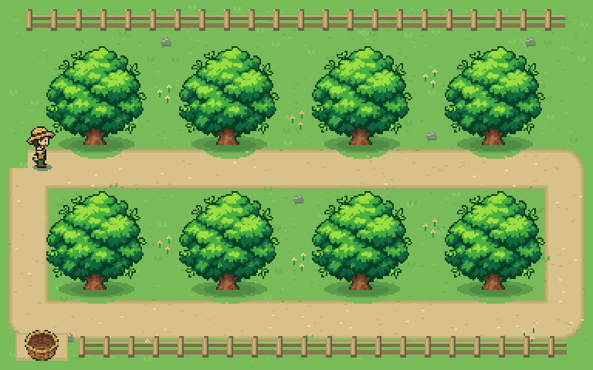

[](https://github.com/yoavshmariahu/treekeeper)

# treekeeper

[](https://github.com/yoavshmariahu/treekeeper/actions/workflows/ci.yml)
[](https://www.npmjs.com/package/@yoavsh/treekeeper)
[](https://nodejs.org)
[](LICENSE)
[](package.json)

**Keep your stray worktrees tidy. No more disk space clutter when using coding agents.**

```bash
npm install -g @yoavsh/treekeeper
```

A coding agent that works in a git worktree per task is wonderful right up to the point where your disk is 40 abandoned checkouts deep, each with its own `node_modules`. The branches pile up too, until `git branch` is a wall of `agent/fix-the-thing-a3f91c`.

treekeeper watches your worktrees, your git history, your pull requests and your agent sessions, and reclaims the ones whose work is already merged. It archives anything unique first, so running it unattended is a reasonable thing to do.

```console
$ treekeeper gc --all
thinker (main)
  RECLAIM  ~/src/thinker/.worktrees/sh-links    [agent/sh-links]     59M  PR #747 merged
  keep     ~/src/thinker/.worktrees/bedrock     [agent/bedrock]           claude-code activity 3m ago
  keep     ~/src/thinker/.worktrees/retry-wip   [agent/retry-wip]         PR #751 is still open
  DELETE   156 merged branches: agent/approve-by-offer agent/astra-compression +154 more

would reclaim 1 worktree (59M) and delete 156 branches · 2 kept
re-run with --apply to do it
```

## Install

Needs Node 20+ and `git`. Install [`gh`](https://cli.github.com) too — without it treekeeper cannot see squash merges, which is how most agent branches land.

Or run it without installing anything:

```bash
npx @yoavsh/treekeeper gc --all
```

## Quick start

```bash
treekeeper gc --all                 # dry run: what could go, and why
treekeeper gc --all --apply         # do it (asks first)
treekeeper daemon install           # ...or never think about it again
```

`treekeeper gc` is always a dry run until you pass `--apply`. The daemon sweeps every 15 minutes in the background.

## What counts as "finished"

This is the whole design, so it is worth being precise. A worktree is removable only when **one** of these is true:

| Signal | How it is detected | Default |
|---|---|---|
| Branch is merged into the default branch | `git merge-base --is-ancestor` | reclaim |
| Pull request was **merged** (incl. squash/rebase) | `gh pr list`, head SHA matched to the local tip | reclaim |
| Pull request was **closed** without merging | `gh pr list` | reclaim after a 7-day grace, commits archived first |
| PR merged, but the local branch has extra commits | PR head SHA ≠ local tip | **keep** (opt in with `onExtraCommits`) |
| Pull request still open | `gh pr list` | keep |
| Nothing says the work landed | — | keep |

**treekeeper never removes a worktree whose commits are not either on the default branch or attached to a merged or closed pull request.** `--force` does not relax that. It is the one invariant everything else is built on.

Then, even for finished work, it holds back if anyone is still there:

- an agent session touched the worktree in the last 20 minutes (`sessions.grace`)
- a running process has its working directory inside it
- the worktree was touched more recently than `minAge` (30 minutes)
- it is your current directory, the repo's main worktree, `git worktree lock`ed, on a protected branch, or matched by `protectPaths`

Uncommitted changes do **not** save a worktree whose work is merged — they get archived and the worktree goes. Set `onDirty: "keep"` if you would rather it stayed.

## Nothing is unrecoverable

Before anything is removed, treekeeper writes an archive to `~/.treekeeper/archive/<repo>/<branch>-<timestamp>/`:

```
commits.bundle      git bundle of commits not on the default branch
uncommitted.patch   git diff HEAD --binary
untracked.tar.gz    untracked, non-ignored files
meta.json           what was removed, when, and why
RESTORE.md          the exact commands to bring it back
```

A cleanly merged worktree has nothing unique in it, so it only gets `meta.json` — an audit record. Anything with real work in it gets the full set.

```bash
treekeeper archive list      # what has been removed lately
treekeeper archive prune     # drop archives past the retention window (14d)
```

## It works with any agent harness

treekeeper decides from **state, not hooks**: git, your forge, and whatever the agents left on disk. So it works with harnesses it has never heard of, and it keeps working when a harness changes its hook API.

**1. Run the daemon and forget it.** Nothing to integrate.

```bash
treekeeper daemon install     # launchd on macOS, systemd --user on Linux
treekeeper daemon status
```

**2. Or call it from a harness hook** — any harness that can run a shell command:

```bash
npx -y @yoavsh/treekeeper gc --all --apply --yes --quiet
```

**3. Or read the plan as JSON** and decide for yourself:

```bash
treekeeper gc --all --json | jq '.summary'
treekeeper gc --all --json | jq -r '.repos[].worktrees[] | select(.verdict.action=="reclaim") | .path'
```

See [docs/integrations.md](docs/integrations.md) for ready-made snippets (Claude Code, Codex CLI, Cursor, Aider, CI).

### Knowing when an agent is still working

| Detector | Signal |
|---|---|
| `claude-code` | transcript mtime in `~/.claude/projects/<slug>/` |
| `codex` | rollout transcript in `~/.codex/sessions/` whose `cwd` is the worktree |
| `aider` | `.aider.chat.history.md` in the worktree |
| `process` | `lsof` — a live process whose cwd is inside the worktree |
| `mtime` | any recently modified file in the worktree |

The last two are the catch-all that covers every other harness: an agent that is working is a process in a directory, writing files. Add your own with a shell command:

```json
{
  "sessions": {
    "commands": [
      { "name": "my-harness", "command": "pgrep -f \"my-agent --cwd $TREEKEEPER_WORKTREE\"" }
    ]
  }
}
```

Exit code 0 means "still working".

## Configuration

`~/.treekeeper/config.json` (run `treekeeper config init` for a starter, `treekeeper config show` for the effective values). JSON with `//` comments and trailing commas allowed.

```jsonc
{
  "roots": ["~/src"],            // where to look for repos
  "maxDepth": 3,
  "minAge": "30m",               // untouched this long before it can go
  "closedPrGrace": "7d",         // extra hold for closed-unmerged PRs
  "onDirty": "archive",          // archive | keep
  "onClosedPr": "archive",       // archive | keep
  "onExtraCommits": "keep",      // archive | keep
  "protectBranches": ["main", "master", "trunk", "develop", "dev", "release/*"],
  "protectPaths": [],            // paths or globs that are never touched
  "pruneBranches": true,         // also delete merged branches with no worktree
  "pruneRemotes": false,         // git remote prune origin after a sweep
  "forge": "github",             // github | none (none = git ancestry only)
  "forgeCacheTtl": "10m",
  "interval": "15m",             // daemon sweep interval
  "sessions": {
    "grace": "20m",
    "detectors": ["claude-code", "codex", "aider", "process", "mtime"],
    "extraPaths": [],            // mtime of these counts as activity; {worktree} is substituted
    "commands": []
  },
  "archive": {
    "enabled": true,
    "dir": "~/.treekeeper/archive",
    "retention": "14d",
    "maxUntrackedBytes": 67108864
  },
  "logFile": "~/.treekeeper/treekeeper.log",
  "logLevel": "info"
}
```

A repo can override any of it, or opt out entirely, with its own `.treekeeper.json`:

```json
{ "enabled": false }
```

## Commands

```
treekeeper gc [path...]     Plan a sweep (default command). --apply to carry it out.
treekeeper status           What is reclaimable right now, plus daemon state.
treekeeper watch            Sweep on an interval in the foreground.
treekeeper daemon <sub>     install | uninstall | start | stop | status | logs
treekeeper archive <sub>    list | prune | path
treekeeper config <sub>     show | path | init
treekeeper doctor           Check git, gh, lsof, config and detectors.
```

Useful flags: `--all`, `--apply`, `-y/--yes`, `--json`, `-v/--verbose` (show what was kept and why), `--force`, `--min-age 2h`, `--branches-only`, `--worktrees-only`, `--forge none`, `--refresh`, `--root <dir>`.

Every removal is appended as JSON to `~/.treekeeper/treekeeper.log`, so there is always an answer to "what happened to that directory".

## Why not just `git worktree prune`?

`git worktree prune` only clears records for directories you already deleted — it never frees a byte. `git branch --merged` misses squash merges, which is how most agent branches land, and neither knows whether an agent is still working in a checkout. treekeeper answers the question those commands cannot: *is this work done, and is anyone still in there?*

## Programmatic use

```ts
import { loadConfig, createForge, discoverRepos, buildPlan, applyPlan, Logger } from "@yoavsh/treekeeper";

const { config } = await loadConfig();
const logger = new Logger({ level: "info" });
const repos = await discoverRepos({ roots: config.roots, maxDepth: config.maxDepth });
const forge = createForge({ kind: config.forge, cacheTtl: config.forgeCacheTtl, logger });

const plan = await buildPlan({ config, repos, forge, logger });
if (plan.summary.worktreesReclaimable > 0) {
  await applyPlan({ plan, config, logger });
}
```

`decideWorktree(facts, policy)` is a pure function if you only want the ruleset.

## Safety notes

- One sweep at a time per machine, enforced by a lock file, so a scheduled sweep and a manual one cannot race.
- Every candidate is re-verified immediately before removal; if the branch, HEAD or contents moved since the plan was built, it is left alone.
- Credentials are scrubbed from all output — remotes with embedded tokens are common, and the log is persistent.
- Removals go through `git worktree remove`, never a blind `rm -rf`.

The full threat model, the archive format and the recovery procedure are in
[docs/safety.md](docs/safety.md).

## Contributing

Issues and pull requests are welcome — see [CONTRIBUTING.md](CONTRIBUTING.md).
Security problems go through [private reporting](SECURITY.md), not a public issue.
`npm test` runs the suite against real git repositories, so it needs `git` on
your PATH and takes about 30 seconds.

## License

[MIT](LICENSE) © Yoav Shmariahu
